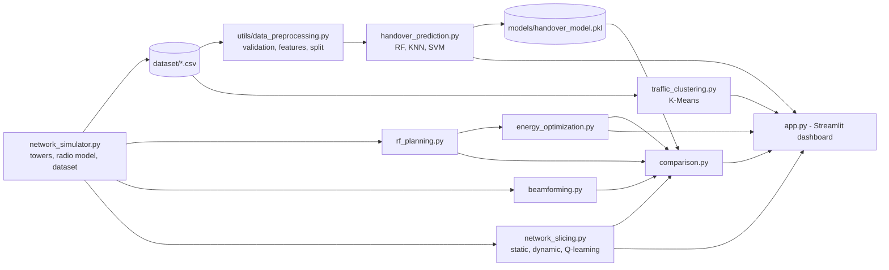
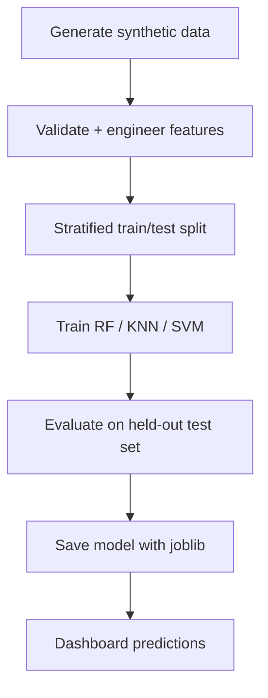
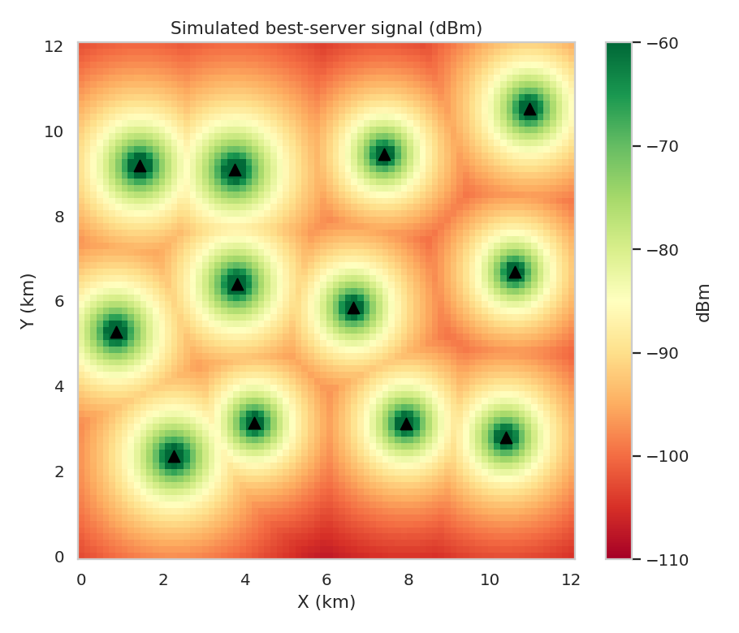
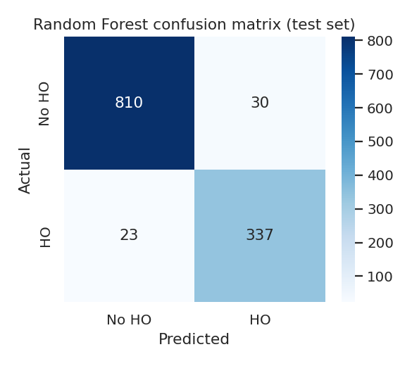
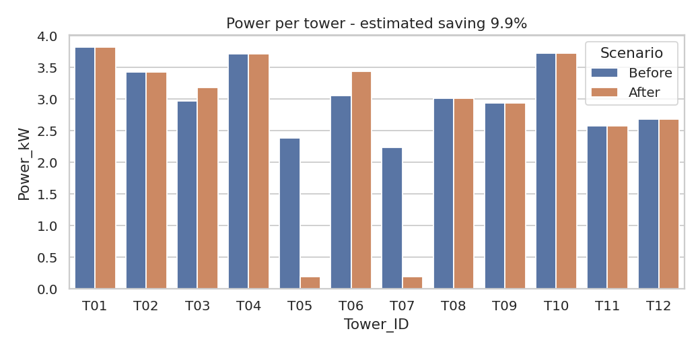
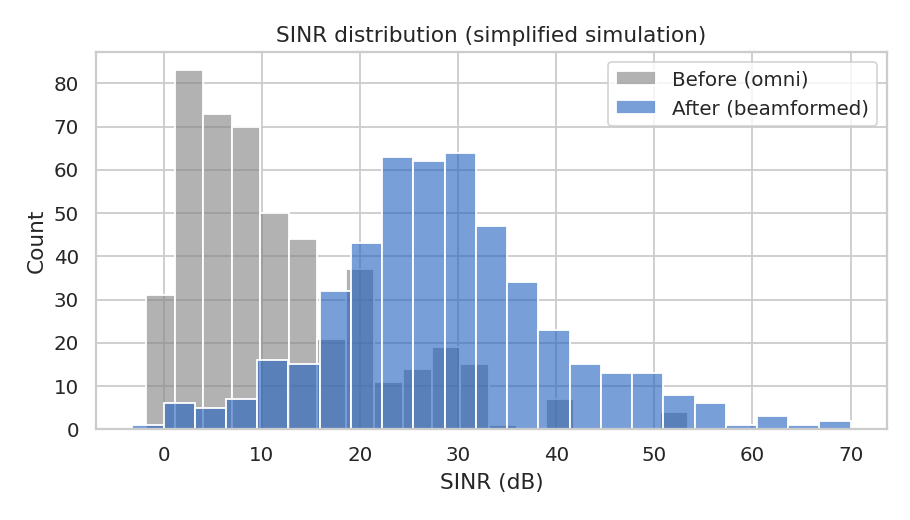

# AI-Driven 5G Network Planning and Optimization System

A Python/Streamlit implementation of the research paper **"AI-Driven Optimization of Radio Network Planning and Design for
Next-Generation Mobile Networks"** (MCA research project).

> **Important:** this is a **simulation**. All data is synthetic, beamforming is a simplified mathematical model, and the
> project does not control real 5G infrastructure or use any real telecom operator's data.

## Project overview
The system simulates a 12 km × 12 km area with 12 base stations and 6,000 users, then applies AI/ML and optimisation
techniques to five radio-network-planning problems, all explorable from an interactive dashboard.

## Research paper connection
| Research area in the paper | Implemented here |
|---|---|
| RF planning | Coverage maps, weak-area detection, greedy new-tower recommendation |
| Beamforming | Simplified uniform-linear-array simulation (before/after SINR, interference) |
| Intelligent handover | **Random Forest** (main), KNN and SVM (comparison), A3-rule baseline |
| Network slicing | eMBB/URLLC/mMTC allocation: static vs dynamic vs **Q-learning** (RL-inspired) |
| Energy efficiency | Constraint-aware sleep-mode optimisation (coverage + capacity preserved) |
| Traffic analysis | **K-Means** clustering |

Literature-only topics (deep learning, digital twins, real-time RL on live networks) are *not* implemented - see Future scope.

## Problem statement
Manual radio planning struggles with dense, dynamic 5G networks: coverage holes, interference, unnecessary handovers,
inefficient resource sharing and high energy use. This project demonstrates how data-driven methods can support these decisions.

## Objectives
1. Simulate a realistic-looking 5G environment and a reproducible synthetic dataset.
2. Train and evaluate ML models for handover prediction.
3. Implement five optimisation modules and compare baseline vs optimised behaviour using calculated results.
4. Provide a clear dashboard, tests and documentation for academic evaluation.

## Technology stack
Python 3.11+ · Pandas · NumPy · Scikit-learn · Streamlit · Plotly · Matplotlib · Seaborn · Joblib · Pytest

## System architecture




## Modules
1. **RF Planning** - best-server RSRP grid, coverage %, weak-signal areas, greedy placement of recommended towers.
2. **Beamforming (simplified simulation)** - ULA array pattern; compares omni vs beamformed SINR and interference. Not physical antenna control.
3. **Handover Management** - predicts whether a user should hand over and to which tower; custom-input form (manual or map-based).
4. **Network Slicing** - allocates one cell's capacity among eMBB, URLLC, mMTC; compares utilisation, unmet demand and SLA satisfaction.
5. **Energy Optimisation** - a tower sleeps only when coverage stays within tolerance **and** neighbours can absorb its traffic; every decision is logged with a reason.

Extra pages: ML Model Performance, **Before vs After Comparison**, About/Methodology.

## Machine learning methodology
* **Data**: synthetic, validated (columns, ranges, nulls, duplicates). Reproducible seed 42.
* **Features**: serving/neighbour signal, user speed, distance, serving/neighbour load, latency, throughput + engineered signal and load differences. The label and IDs are excluded (no target leakage).
* **Split**: stratified 80/20 train/test.
* **Models trained**: Random Forest (200 trees, balanced class weights), KNN (k=15), SVM (RBF) - last two with standard scaling.
* **Evaluation**: accuracy, precision, recall, F1, confusion matrix, 5-fold CV F1 (Random Forest).
* **Unsupervised**: K-Means (k selectable, silhouette reported). **RL-inspired**: tabular Q-learning for slicing.

## Dataset description
`dataset/network_data.csv` (6,000 rows) and `dataset/towers.csv` (12 rows) are **synthetic**. Columns include `User_ID`, `Tower_ID`,
`Signal_Strength_dBm`, `Network_Speed_Mbps`, `Latency_ms`, `User_Speed_kmh`, `Tower_Distance_km`, `Network_Traffic_Percentage`,
`Bandwidth_MHz`, `Power_Consumption_kWh`, `Handover_Required`, plus helper columns (service type, position, best neighbour).
Regenerate any time with `python generate_dataset.py`.

## Installation (Windows 11)
```powershell
git clone <your-repository-url>
cd AI-Driven-5G-Network-Optimization
python -m venv venv
venv\Scripts\activate
pip install -r requirements.txt
```

## How to run
```powershell
python generate_dataset.py     # optional - CSVs are already included
python train_model.py          # optional - model is already included; retrains and prints metrics
python generate_figures.py     # optional - static report figures
streamlit run app.py           # opens http://localhost:8501
```
Run tests: `pip install -r requirements-dev.txt` then `python -m pytest -q`

## Dashboard screenshots
*Screenshots are not included.* After running the app, take your own screenshots and place them in `assets/project_images/`.
Charts generated by `generate_figures.py` (real simulation output, not dashboard screenshots):

| RF coverage map | Confusion matrix |
|---|---|
|  |  |

| Energy before/after | Beamforming SINR |
|---|---|
|  |  |

## Model performance results
Measured on the held-out test set (1,200 synthetic users, seed 42). Results describe the simulator, **not** a real network.

| Model | Accuracy | Precision | Recall | F1 |
|---|---|---|---|---|
| Random Forest | 0.956 | 0.918 | 0.936 | 0.927 |
| K-Nearest Neighbors | 0.948 | 0.936 | 0.889 | 0.912 |
| SVM (RBF) | 0.958 | 0.910 | 0.956 | 0.932 |

Random Forest 5-fold CV F1: 0.924 ± 0.009. Random Forest confusion matrix `[[810, 30], [23, 337]]`.

Baseline-vs-optimised snapshot (default settings; the dashboard recomputes these live):

| Metric | Baseline | Optimised |
|---|---|---|
| Area coverage ≥ −100 dBm (3 recommended towers) | 92.8 % | 98.9 % |
| Mean SINR, omni → 16-element beamforming (simplified) | 11.7 dB | 28.9 dB |
| Unnecessary handovers, A3 rule → ML (test set) | 107 | 30 |
| Slice SLA satisfaction, static → dynamic | 66.7 % | 97.2 % |
| Total power, before → after sleep mode | 36.57 kW | 32.94 kW (−9.9 %) |
| Coverage after sleep mode (≥ −105 dBm) | 99.52 % | 99.44 % (slightly *worse*) |

## Limitations
* Synthetic data and simplified propagation - not validated against any operator network.
* Handover labels come from the same generator the model learns from, so high scores and the edge over the A3 rule are partly built in.
* Beamforming is an analytical array pattern, not real beam management.
* Static snapshot: no time-varying mobility or ping-pong handover simulation.
* Q-learning is a small demonstration, not guaranteed to beat the dynamic heuristic.

## Future scope
Real measurement data, ray-tracing propagation, deep reinforcement learning, time-series mobility, digital twins, O-RAN integration.

## Deployment (Streamlit Community Cloud)
1. Push the repository to GitHub (see below).
2. On [share.streamlit.io](https://share.streamlit.io) choose **New app**, select your repository, branch `main`, main file `app.py`, Python 3.11+.
3. Streamlit installs `requirements.txt` automatically.
4. The CSVs and model are committed. If missing or incompatible with the cloud scikit-learn version, `app.py` regenerates the data (seed 42) and retrains the model in memory automatically.

## Upload to GitHub
```powershell
git init
git add .
git commit -m "Initial commit: AI-Driven 5G Network Optimization"
git branch -M main
git remote add origin https://github.com/<your-username>/AI-Driven-5G-Network-Optimization.git
git push -u origin main
```

## Project structure
```
app.py  train_model.py  generate_dataset.py  generate_figures.py
modules/  rf_planning, beamforming, handover_prediction, network_slicing, energy_optimization,
          traffic_clustering, comparison, network_simulator
utils/    data_preprocessing, metrics, visualization
dataset/  models/  docs/methodology.md  tests/  assets/project_images/
```

## Author
**[Your Name]** - MCA, [Your University] · [Your email / LinkedIn - add your own]

Licence: add a licence of your choice (e.g. MIT) before publishing.
